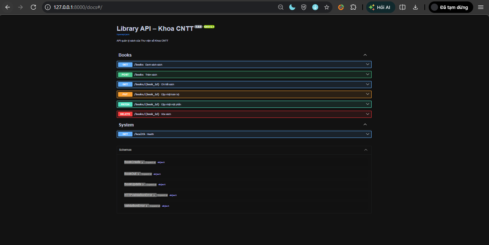
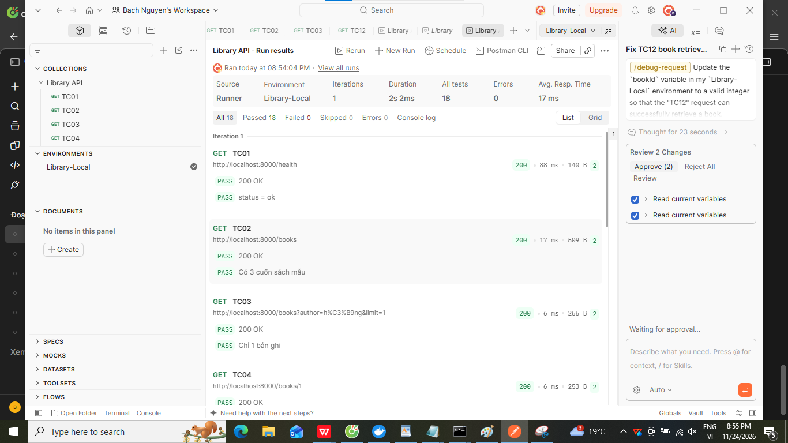

# Library API – Thư viện số Khoa CNTT

API quản lý sách xây dựng bằng FastAPI, kiểm thử bằng Postman. Bài thực hành số 4, học phần Lập trình mã nguồn mở (POS02024).

## Case study

Thư viện Khoa CNTT quản lý sách bằng tệp Excel nên việc tra cứu thủ công mất thời gian. Library API cung cấp dữ liệu sách dạng JSON để website thư viện và ứng dụng di động của sinh viên cùng sử dụng.

Quy tắc nghiệp vụ chính:
- Xem danh sách sách, tìm theo tên sách hoặc tác giả, có phân trang.
- Xem chi tiết một cuốn sách theo `id`.
- Thêm sách mới; mỗi ISBN là duy nhất.
- Cập nhật toàn bộ (PUT) hoặc một phần (PATCH).
- Xóa sách khỏi hệ thống.

Dữ liệu lưu trong bộ nhớ nên sẽ mất khi khởi động lại server.

## Cài đặt và chạy

Yêu cầu: Python 3.10 trở lên.

```bash
git clone <link-repo>
cd library-api
python -m venv .venv
# Windows:      .venv\Scripts\activate
# Linux/WSL:    source .venv/bin/activate
pip install "fastapi[standard]"
python -m uvicorn app.main:app --reload
```

Mở http://127.0.0.1:8000/docs để xem tài liệu Swagger.

## Danh sách endpoint

| Phương thức | Endpoint | Chức năng | Thành công | Lỗi |
| --- | --- | --- | --- | --- |
| GET | /books | Danh sách; lọc `?q=`, `?author=`; phân trang `?skip=`, `?limit=` | 200 | 422 |
| GET | /books/{id} | Chi tiết một cuốn sách | 200 | 404 |
| POST | /books | Thêm sách mới | 201 | 409, 422 |
| PUT | /books/{id} | Cập nhật toàn bộ | 200 | 404, 409, 422 |
| PATCH | /books/{id} | Cập nhật một phần | 200 | 404, 422 |
| DELETE | /books/{id} | Xóa sách | 204 | 404 |

Ngoài ra có `GET /health` để kiểm tra server.

## Kiểm thử bằng Postman

1. Import `postman/Library-API.postman_collection.json` và `postman/Library-Local.postman_environment.json` vào Postman.
2. Chọn environment **Library-Local** (biến `baseUrl = http://localhost:8000`).
3. Khởi động lại server để dữ liệu về trạng thái ban đầu.
4. Chuột phải collection **Library API** → Run collection, chạy TC01 đến TC12 theo thứ tự.

Kết quả mong đợi: 12 test case đều Passed.

## Ảnh minh chứng

Swagger UI:



Kết quả Collection Runner:

